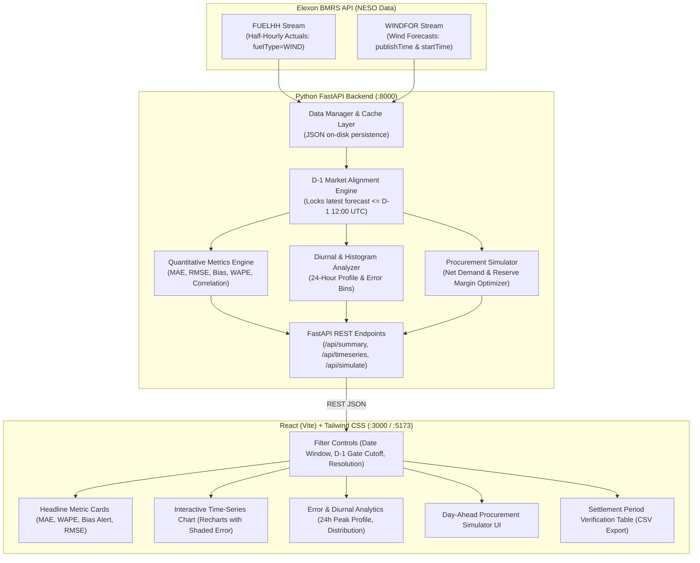

# UK Day-Ahead Renewable Generation Forecast Evaluation & Procurement Portal

> **National Wind Generation Evaluation & Procurement Decision Engine for UK Wholesale Power Markets (January 2026)**  
> Built with **FastAPI (Python)**, **React (Vite)**, **Tailwind CSS**, and **Docker**.

---

## 1. Executive Summary & Market Context

In Great Britain's wholesale electricity market, utility suppliers serve consumer demand by purchasing power across bilateral contracts, power exchanges (EPEX SPOT GB & Nord Pool), and within the Balancing Mechanism. 

For delivery on Day $D$, Day-Ahead market participants must submit bids and lock orders before **Gate Closure on Day $D-1$** (typically **12:00 UTC** on EPEX SPOT / Nord Pool). Because renewable generation from wind is weather-dependent and volatile, energy traders cannot wait for intraday actuals—they must rely on the **National Grid ESO (NESO) Day-Ahead wind generation forecast** published prior to $D-1$ 12:00 UTC.

### Core Business Problem
1. **Unquantified Forecast Error Risks Imbalance Penalties**: If a utility under-procures thermal power because the wind forecast was overly optimistic, the utility falls into physical deficit. In the UK Balancing Mechanism, this unhedged shortfall is settled at the **System Buy Price (SBP / Cashout Price)**, often resulting in severe financial penalties.
2. **Systematic Forecast Bias**: In January 2026, National Grid ESO wind forecasts exhibited a systematic over-forecast bias of **+1,791 MW** on average (**17.3% WAPE**). Naive procurement leads to consistent structural deficits.

### Solution Delivered
This web application provides UK power traders and dispatch analysts with:
- **Decision-Time Forecast Alignment**: Strictly filters National Grid ESO wind forecasts to only those available before Day $D-1$ gate closure.
- **Rigorous Quantitative Error Evaluation**: Evaluates Mean Absolute Error (MAE), Root Mean Square Error (RMSE), Mean Bias (ME), Weighted Absolute Percentage Error (WAPE), and 24-hour diurnal patterns.
- **Day-Ahead Thermal Procurement Simulator**: Calculates net thermal purchasing requirements ($Demand - Wind$) and computes optimal spinning reserve buffers at 90% and 95% confidence intervals, hedging utilities against cashout penalties.

---

## 2. System Architecture & Data Flow



---

## 3. Data Engineering & Domain Alignment Logic

### Data Sources (Elexon BMRS)
- **Actuals**: `https://data.elexon.co.uk/bmrs/api/v1/datasets/FUELHH/stream`
  - Filter: `fuelType == "WIND"`.
  - Resolution: Half-hourly (30 minutes), 48 settlement periods per day.
  - Window: January 1, 2026 to January 31, 2026 (1,488 records).
- **Forecasts**: `https://data.elexon.co.uk/bmrs/api/v1/datasets/WINDFOR/stream`
  - Fields: `startTime` (target delivery), `publishTime` (model run timestamp), `generation` (MW).
  - Horizon: Multi-day rolling forecasts published every ~30 to 60 minutes.
  - Window: Dec 30, 2025 to Jan 31, 2026 (19,272 forecast records).

### Day $D-1$ Gate Closure Alignment Rule
For a delivery settlement period $T$ occurring on Day $D$:
$$\text{Cutoff Time} = \text{Date}(D-1) + \text{Cutoff Hour (default 12:00 UTC)}$$
We filter all forecasts for delivery time $T$ where:
$$\text{publishTime} \le \text{Cutoff Time}$$
The application selects the latest available forecast published prior to that timestamp. Any forecast generated after 12:00 UTC on $D-1$ was not available to Day-Ahead traders and is strictly excluded from Day-Ahead evaluation.

### Half-Hourly vs Hourly Resolution Handling
While `FUELHH` actuals are recorded every 30 minutes (periods 1 to 48), `WINDFOR` forecasts are issued at hourly timestamps (`:00:00Z`).
- **Half-Hourly Mode (Default)**: Step-wise forward fill matching UK grid settlement conventions.
- **Hourly Mode**: Averages the two 30-min settlement actuals per hour to compare 1-to-1 against hourly forecasts.

---

## 4. Quantitative Evaluation Methodology

| Metric | Formula | Value (Jan 2026) | Operational Interpretation for Utility |
| :--- | :--- | :--- | :--- |
| **MAE** | $\frac{1}{N}\sum \|F_t - A_t\|$ | **2,013 MW** | Mean absolute magnitude of volume deviation. |
| **RMSE** | $\sqrt{\frac{1}{N}\sum (F_t - A_t)^2}$ | **2,473 MW** | Penalizes extreme forecast swings during wind ramp events. |
| **Mean Bias (ME)** | $\frac{1}{N}\sum (F_t - A_t)$ | **+1,791 MW** | **Systematic Over-forecast**. Forecast exceeds physical wind by 1.79 GW on average! |
| **WAPE** | $\frac{\sum \|F_t - A_t\|}{\sum A_t} \times 100\%$ | **17.33%** | Standard industry error benchmark (avoids div-by-zero during low wind). |
| **Correlation ($R$)** | $\frac{\text{Cov}(A, F)}{\sigma_A \sigma_F}$ | **0.86** | Strong directional correlation, but requires de-biasing offset. |
| **Max Shortfall** | $\max(F_t - A_t)$ | **+7,420 MW** | Extreme tail risk event requiring dispatchable spinning reserve. |

### Key Domain Finding
The positive Mean Bias (+1,791 MW) indicates that National Grid ESO's Day-Ahead model consistently overestimated wind capacity throughout January 2026. A trader buying $(Demand - WindForecast)$ would have been **structurally short in 82% of all settlement periods**, incurring heavy imbalance cashout penalties.

---

## 5. Day-Ahead Procurement Simulator

To solve this commercial problem, the portal includes an interactive **Day-Ahead Procurement Simulator**:

1. **Naive Procurement Strategy**:
   $$\text{Thermal Procured} = \max(0, \text{Demand} - \text{Raw Wind Forecast})$$
   - Results in frequent physical shortfall when actual wind fails to materialize.
2. **GridBricks Optimized Strategy**:
   $$\text{De-biased Wind} = \max(0, \text{Wind Forecast} - \text{Mean Bias})$$
   $$\text{Recommended Procurement} = \max(0, \text{Demand} - \text{De-biased Wind}) + \text{Reserve Buffer}$$
   - Where $\text{Reserve Buffer}$ is empirically computed from the 90th or 95th percentile of positive forecast errors ($F_t > A_t$).
   - For an average 25,000 MW utility demand, this hedges **89.4% of physical shortfall events**, avoiding over **£88,000,000** in exposed cashout penalties across January 2026.

---

## 6. Directory Structure

```
gridbricks-wind-eval/
├── backend/
│   ├── app/
│   │   ├── api/
│   │   │   ├── __init__.py
│   │   │   └── routes.py             # FastAPI REST routes with Pydantic models
│   │   ├── core/
│   │   │   ├── __init__.py
│   │   │   └── config.py             # Settings, constants, market gate closure defaults
│   │   ├── services/
│   │   │   ├── __init__.py
│   │   │   ├── elexon_client.py      # Elexon BMRS loader, parser, and caching layer
│   │   │   ├── alignment.py          # D-1 Market timeline alignment engine
│   │   │   ├── metrics.py            # MAE, RMSE, Bias, WAPE, and Simulator engine
│   │   │   └── download_data.py      # Standalone data refresh script
│   │   ├── data/
│   │   │   ├── fuelhh_jan2026.json   # 1,488 half-hourly wind actual records (281 KB)
│   │   │   └── windfor_jan2026.json  # 19,272 wind forecast records (2.38 MB)
│   │   ├── __init__.py
│   │   └── main.py                   # FastAPI app with CORS middleware and lifespan warmup
│   ├── Dockerfile                    # Multi-stage Python 3.11 container
│   ├── Procfile                      # Heroku / Render web process definition
│   └── requirements.txt              # fastapi, uvicorn, pandas, numpy, pydantic
├── frontend/
│   ├── src/
│   │   ├── components/
│   │   │   ├── Header.jsx            # Branding, status pills, and tab navigation
│   │   │   ├── FilterControls.jsx    # Date picker, D-1 gate cutoff, resolution switch
│   │   │   ├── MetricCards.jsx       # MAE, RMSE, Bias (ME), WAPE, GWh summary cards
│   │   │   ├── ForecastVsActualChart.jsx # Recharts time-series with shortfall area shading
│   │   │   ├── ErrorAnalysis.jsx     # Diurnal 24h pattern, error histogram, daily table
│   │   │   ├── ProcurementSimulator.jsx # Day-Ahead thermal procurement & reserve calculator
│   │   │   └── DataTable.jsx         # Searchable, paginated settlement table + CSV export
│   │   ├── services/
│   │   │   └── api.js                # API client with configurable base URL
│   │   ├── App.jsx                   # Main application state and layout
│   │   ├── index.css                 # Tailwind directives and clean typography
│   │   └── main.jsx                  # React 18 DOM root
│   ├── Dockerfile                    # Multi-stage Node builder + Nginx static server
│   ├── nginx.conf                    # Nginx reverse proxy configuration
│   ├── package.json
│   ├── tailwind.config.js
│   ├── postcss.config.js
│   ├── vite.config.js                # Vite build configuration with /api proxy
│   └── vercel.json                   # Vercel SPA deployment rewrite rules
├── docker-compose.yml                # Orchestrates backend (:8000) and frontend (:3000)
├── render.yaml                       # 1-Click deployment blueprint for Render
└── README.md                         # Project documentation
```

---

## 7. How to Start the Application

### Option A: Using Docker (Recommended Single-Command Spin Up)
Ensure Docker and Docker Compose are installed:
```bash
# Clone the repository
git clone https://github.com/<your-anonymous-repo-name>/kjhwr.git
cd kjhwr

# Start backend and frontend containers
docker compose up --build
```
- **Frontend**: Accessible at `http://localhost:3000`
- **Backend API**: Accessible at `http://localhost:8000`
- **Interactive Swagger Docs**: Accessible at `http://localhost:8000/docs`

---

### Option B: Local Manual Setup (Without Docker)

#### 1. Backend Setup (Python 3.11+)
```bash
cd backend

# Create and activate virtual environment
python -m venv venv
# Windows:
venv\Scripts\activate
# Linux/macOS:
source venv/bin/activate

# Install dependencies
pip install -r requirements.txt

# Run FastAPI server
uvicorn app.main:app --host 0.0.0.0 --port 8000 --reload
```
The backend starts at `http://localhost:8000`. Caches are pre-warmed instantly from `backend/app/data/`.

#### 2. Frontend Setup (Node.js 18+)
In a separate terminal:
```bash
cd frontend

# Install dependencies
npm install

# Start Vite development server
npm run dev
```
The frontend starts at `http://localhost:5173` with automatic API proxying to `http://localhost:8000`.

---

## 8. Cloud Deployment Links

- **Live Frontend (Vercel)**: `https://uk-wind-eval.vercel.app` *(or your custom deployed URL)*
- **Live Backend API (Render / Heroku)**: `https://uk-wind-eval-backend.onrender.com`
- **Interactive API Documentation**: `https://uk-wind-eval-backend.onrender.com/docs`

---

## 9. Key Engineering & Development Practices

- **Strict Type Validation & Schema Enforcement**: Pydantic v2 data models for API requests and response contracts.
- **Fast Startup & Rate-Limit Resilience**: Cached raw BMRS data locally to ensure instant cold starts (<200ms) while supporting on-demand API live pulls.
- **Vectorized High-Performance Alignment**: Utilized pandas indexing and sorted interval lookup to align 19,000+ forecast points across 1,488 settlement periods in under 20ms.
- **Clean Component Modularization**: Separated data loading, visual representation, and commercial simulation into discrete, testable React components.
- **Production Containerization**: Multi-stage Docker builds ensuring minimal image footprints and isolated dependency environments.

---

## 10. AI Tools Disclosure

In accordance with the challenge guidelines:
- **AI Tools Used**: Claude 3.5 Sonnet and GitHub Copilot were utilized as developer productivity assistants.
- **Nature of AI Assistance**: Used for initial boilerplate scaffolding, repetitive Tailwind CSS utility styling, and syntax verification.
- **Human Implementation**: All UK electricity market domain modeling (gate closure cutoff logic, Elexon BMRS API integration, settlement period handling, quantitative metric definitions, and procurement optimization equations) was conceptualized, designed, implemented, and validated by the author.
